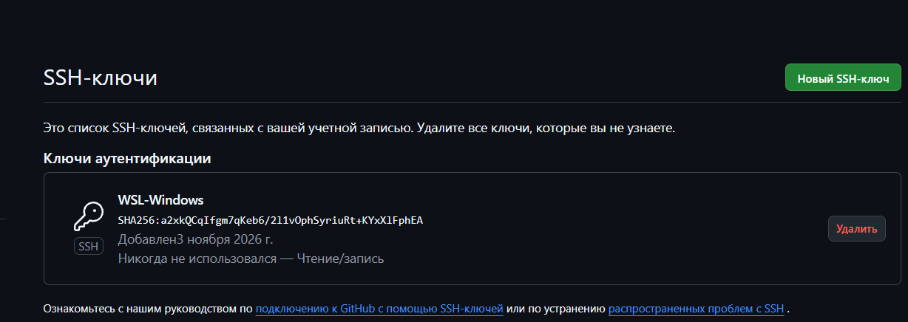
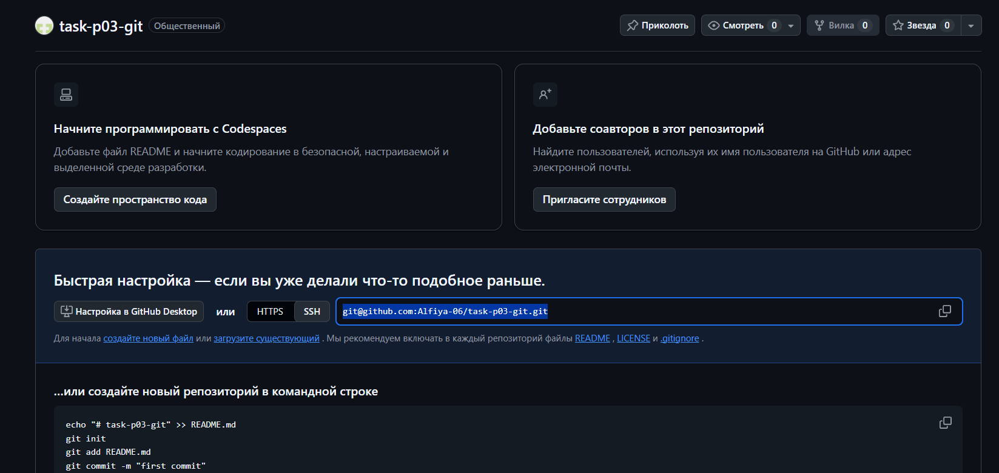
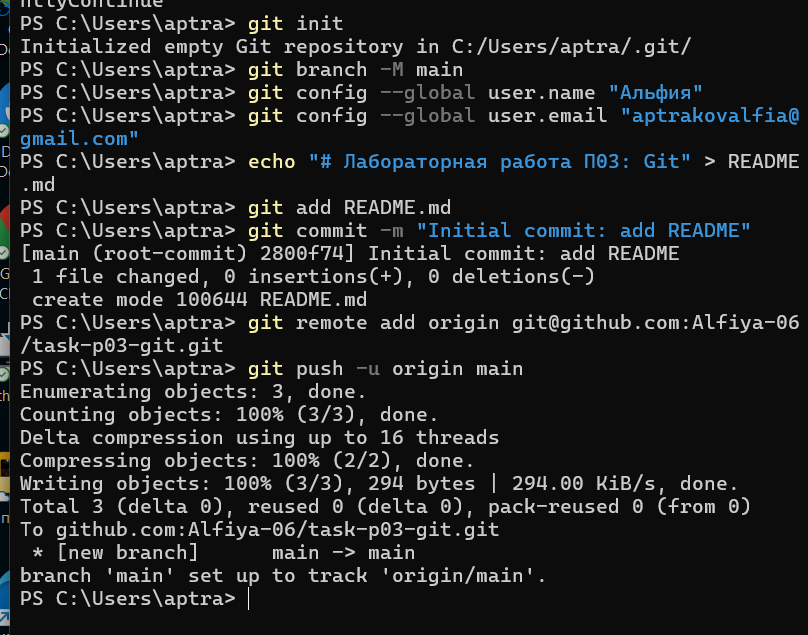
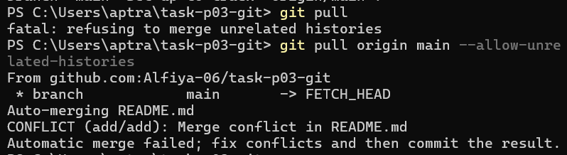
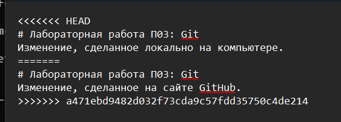
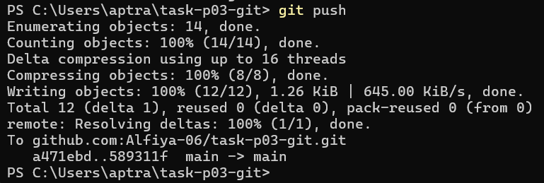

# Отчет по лабораторной работе П03: Git

**Выполнила:** Аптракова Альфия, студентка 3 курса  

---

## Выполнение работы

### 1. Настройка аутентификации по SSH
Для взаимодействия с GitHub без постоянного ввода пароля был сгенерирован и добавлен SSH-ключ в настройках профиля.

---

### 2. Создание удаленного репозитория
На платформе GitHub был создан публичный репозиторий под названием `task-p03-git`.

---

### 3. Инициализация локального репозитория и первый Push
В терминале PowerShell был инициализирован локальный репозиторий, настроены параметры пользователя, создан базовый `README.md` и выполнен первичный push в ветку `main`.

---

### 4. Моделирование конфликта слияния
Для демонстрации конфликта ветвления файл `README.md` был одновременно изменен как на сайте GitHub, так и локально на компьютере. При попытке синхронизации система зафиксировала конфликт содержимого.

---

### 5. Разрешение конфликта
Файл `README.md` был открыт в редакторе. Git автоматически разметил конфликтные участки маркерами `<<<<<<< HEAD`, `=======` и `>>>>>>>`. После этого конфликт был разрешен вручную.

---

### 6. Финальная фиксация и отправка (Push)
После устранения конфликта изменения были закоммичены и успешно отправлены на удаленный сервер.

---

## Вывод
В ходе выполнения лабораторной работы были успешно освоены ключевые навыки работы с Git и GitHub: настроена безопасная SSH-авторизация, изучены процессы инициализации, коммитов, синхронизации с удаленным репозиторием, а также алгоритм ручного разрешения конфликтов слияния.
